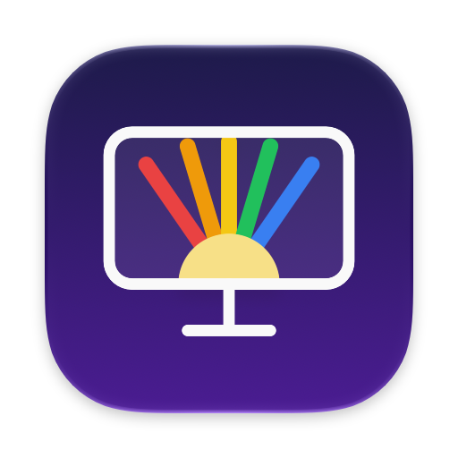

<p align="center">
  
</p>

<h1 align="center">AllForMonitors</h1>

<p align="center">
  Brillo, contraste, volumen, color y entradas de cualquier monitor, desde la barra de menú de tu Mac.<br>
  <i>Brightness, contrast, volume, color and inputs of any monitor, from your Mac's menu bar.</i>
</p>

---

## Español

AllForMonitors controla tus monitores externos por el cable de video (DDC/CI), como si fueran pantallas de Apple: brillo, contraste, volumen, modos de color y cambio de entrada, con las teclas de tu teclado y escenas automáticas.

**Estado:** beta próximamente. Este repositorio guarda las descargas y las actualizaciones; el código de la app es privado.

### Requisitos

- macOS 14 Sonoma o posterior (con Liquid Glass en macOS 26 o posterior).
- Mac con Apple Silicon (M1 o posterior).

### Instalar

- **Descarga:** el `.dmg` más reciente en [Releases](https://github.com/Diegoafigue/AllForMonitors-releases/releases). Ábrelo y arrastra AllForMonitors a Aplicaciones.
- **Homebrew:**

  ```bash
  brew install --cask diegoafigue/tap/allformonitors
  ```

### Actualizaciones

La app avisa sola cuando hay una versión nueva y se actualiza desde **Ajustes › Acerca de**. Si la instalaste con Homebrew, también puedes usar `brew upgrade --cask --greedy allformonitors`.

### Comentarios y errores

Abre un [issue](https://github.com/Diegoafigue/AllForMonitors-releases/issues) con el modelo de tu monitor, cómo está conectado (HDMI, DisplayPort, USB-C o dock) y tu versión de macOS.

---

## English

AllForMonitors controls your external monitors over the video cable (DDC/CI), as if they were Apple displays: brightness, contrast, volume, color modes and input switching, with your keyboard's keys and automatic scenes.

**Status:** beta coming soon. This repository holds the downloads and updates; the app's source code is private.

### Requirements

- macOS 14 Sonoma or later (Liquid Glass on macOS 26 or later).
- A Mac with Apple Silicon (M1 or later).

### Install

- **Download:** the latest `.dmg` from [Releases](https://github.com/Diegoafigue/AllForMonitors-releases/releases). Open it and drag AllForMonitors to Applications.
- **Homebrew:**

  ```bash
  brew install --cask diegoafigue/tap/allformonitors
  ```

### Updates

The app tells you when a new version is out and updates from **Settings › About**. If you installed it with Homebrew, `brew upgrade --cask --greedy allformonitors` works too.

### Feedback and bugs

Open an [issue](https://github.com/Diegoafigue/AllForMonitors-releases/issues) with your monitor's model, how it's connected (HDMI, DisplayPort, USB-C or a dock) and your macOS version.

---

AllForMonitors © 2026 Diego Figueroa. Free to download and use; see [LICENSE](LICENSE).
